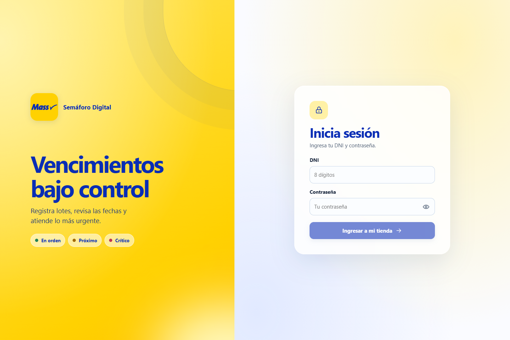
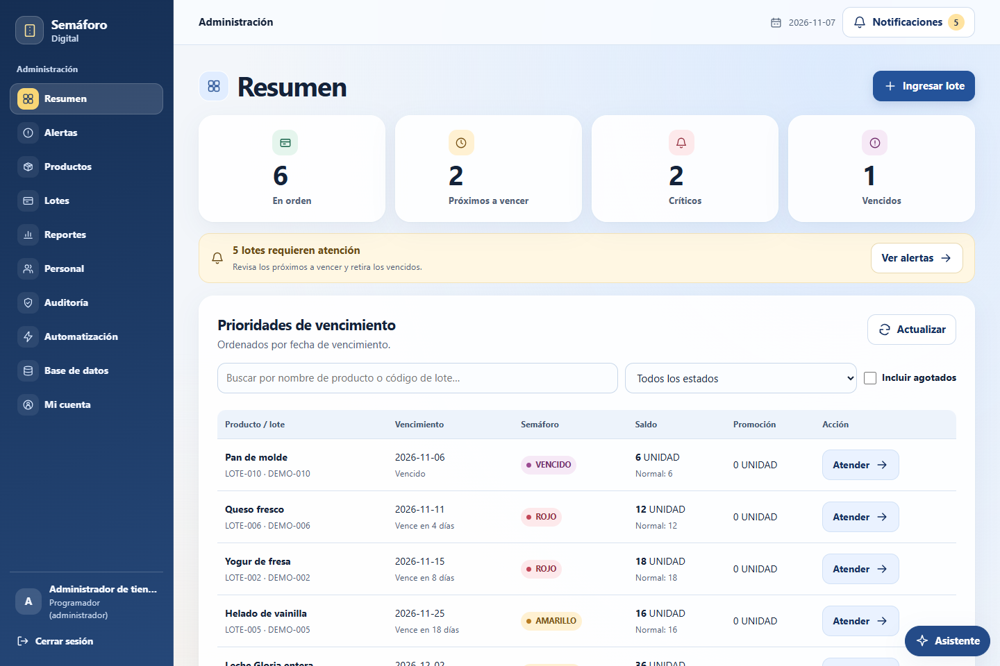
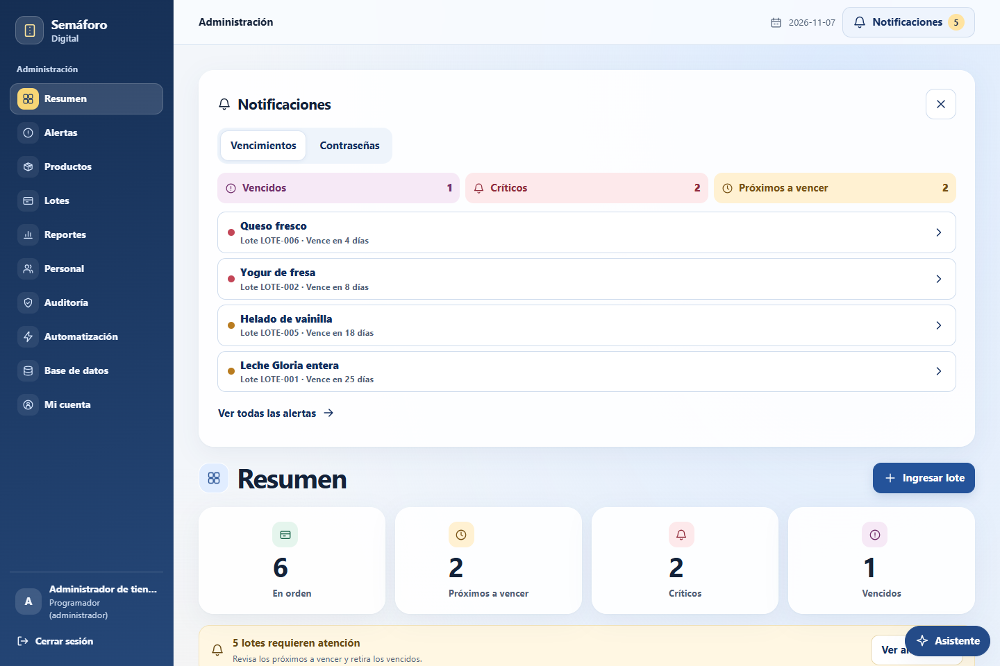
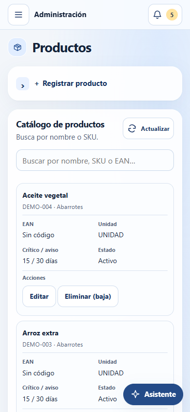
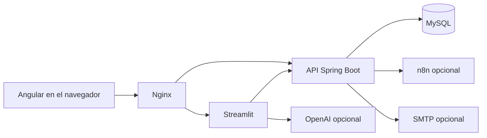

# Semáforo Digital Mass

**Control de inventario y vencimientos para una tienda.**

Aplicación web que permite registrar productos y lotes, identificar qué mercadería requiere atención y conservar el historial de ingresos, ventas, promociones y mermas. El semáforo organiza la revisión por fecha de vencimiento y los permisos distribuyen el trabajo entre empleado, supervisor y programador.

Proyecto académico del curso Integrador II de la Universidad Tecnológica del Perú. Puede ejecutarse en local mediante Docker Compose y cuenta con una versión de demostración desplegada en Railway.

## Entrega final del 7 de noviembre de 2026

- [Abrir la aplicación publicada](https://semaforo-digital-mass-production.up.railway.app/login).
- [Documentos Word de los puntos 22 y 23 y resumen de una hoja](entregables/README.md).
- [Despliegue y validación final](docs/despliegue-railway.md), [resultados originales](docs/deployment-validation) y [capturas](docs/evidence).
- [Mediciones de rendimiento locales con k6](docs/performance-2026-11-07).

El código funcional desplegado está identificado por la etiqueta **v1.1.0**. Esta rama incorpora además la documentación y las evidencias posteriores, incluida la prueba aprobada del asistente GPT en Railway. No se publican claves, contraseñas ni respaldos privados de MySQL.

[Funciones](#qué-incluye) · [Capturas](#vista-previa) · [Instalación](#cómo-abrirla) · [Arquitectura](#arquitectura) · [Base de datos](#base-de-datos) · [Pruebas](#pruebas) · [CI/CD](#estado-de-cicd)

## Avisos de vencimiento en pantalla

El servidor también incorpora [alertas por correo y su historial](docs/alertas-correo.md). En Railway, el envío automático está activado y utiliza Resend por HTTPS; se verificaron un correo recibido y un aviso automático nuevo. La configuración utiliza variables privadas.

La aplicación muestra un aviso con producto, lote, fecha y saldo cuando detecta lotes críticos o vencidos con stock. Revisa todas las páginas de alertas al actualizar o cambiar de apartado y cada 45 segundos mientras la pestaña está visible y conectada.

El botón **Sonido desactivado** permite habilitar una señal breve; requiere pulsarlo en cada nueva sesión de página por las restricciones del navegador. Al cerrar un aviso, no se repite por el mismo lote y estado durante esa sesión. Si pasa de crítico a vencido, vuelve a avisar. Al recargar la página se inicia una nueva sesión de avisos.

El aviso visual y el sonido requieren mantener abierta la aplicación. El correo es independiente: puede enviarse con el navegador cerrado mientras el servidor y MySQL estén encendidos y el envío esté configurado y activado. No se implementaron envíos por WhatsApp ni notificaciones del sistema con la aplicación cerrada. Los umbrales de vencimiento son los configurados para cada producto.

## Objetivos del sistema

- Centralizar el registro de productos, lotes y cantidades disponibles.
- Priorizar los lotes próximos a vencer para facilitar su revisión.
- Registrar las decisiones de venta, promoción y merma con responsable e historial.
- Aplicar permisos según las responsabilidades del personal.
- Facilitar las consultas de inventario con búsqueda automática y un asistente de apoyo.

La reducción de mermas y el ahorro de tiempo son objetivos del proyecto. Su impacto todavía requiere mediciones en una tienda real.

## Vista previa

Capturas de la interfaz vigente, tomadas con una base de demostración independiente. Los productos, cantidades y costos son ficticios.

### Inicio de sesión

Acceso con DNI y contraseña, identidad visual amarilla y azul, y diseño adaptable a la pantalla.



### Resumen del inventario

Conteo de lotes por prioridad, acceso a alertas y listado ordenado por vencimiento.



<details>
<summary>Ver la campana de notificaciones</summary>

La campana permite consultar los vencimientos y abrir el listado filtrado. El programador dispone de una pestaña adicional para las solicitudes de contraseña.



</details>

<details>
<summary>Ver el catálogo en un teléfono</summary>

En pantallas estrechas, las filas se presentan como fichas con sus campos identificados. La navegación se abre desde el botón de menú.



</details>

Después de iniciar los servicios, la instalación estándar se abre en [localhost:4200/login](http://localhost:4200/login). El despliegue público está pendiente.

## Qué incluye

| Apartado | Funciones disponibles |
| --- | --- |
| Resumen | Conteo de lotes en orden, próximos a vencer, críticos y vencidos. Acceso directo a cada estado. |
| Alertas | Consulta de los lotes con saldo que requieren atención, prioridad por vencimiento y seguimiento de acciones. |
| Productos | Catálogo con nombre, categoría, SKU, EAN-13 opcional, unidad y plazos de aviso. |
| Lotes | Registro de ingresos y movimientos de venta, promoción, merma, ajuste y reversión según permisos. |
| Búsqueda | Actualización automática al escribir en Resumen, Alertas, Productos y Lotes. También aplica cambios de estado y la opción de incluir agotados. |
| Notificaciones | Panel de vencimientos para los tres roles y solicitudes de contraseña para el programador. |
| Reportes | Consulta de movimientos y exportación CSV para supervisor y programador. |
| Administración | Gestión de personal, contraseñas, auditoría, automatización y visor de tablas en español. |
| Asistente | Chatbot Streamlit con contexto autorizado del inventario y conexión opcional a OpenAI. |

La búsqueda agrupa las pulsaciones durante **250 ms**, cancela la consulta anterior cuando cambia el texto y devuelve hasta **25 registros por página**. El filtrado se realiza en el servidor. Los plazos de aviso se configuran por producto.

### Roles y permisos

| Operación | Empleado | Supervisor | Programador |
| --- | :---: | :---: | :---: |
| Consultar productos, lotes y alertas | Sí | Sí | Sí |
| Registrar ingresos, ventas, promociones y mermas | Sí | Sí | Sí |
| Crear y editar productos | — | Sí | Sí |
| Ajustar saldos y revertir movimientos permitidos | — | Sí | Sí |
| Consultar reportes y exportar CSV | — | Sí | Sí |
| Dar de baja productos y administrar personal | — | — | Sí |
| Consultar costos y datos de administración | — | — | Sí |
| Asignar contraseñas al personal | — | — | Sí |
| Consultar el chatbot | Sí | Sí | Sí |

Los permisos se validan en la API. El empleado y el supervisor solicitan el cambio de contraseña desde **Mi cuenta**. El programador atiende la solicitud en su panel y comunica la nueva clave por un canal privado.

Las ventas y promociones de lotes vencidos se rechazan. Los ajustes y las reversiones se registran como movimientos para conservar la trazabilidad.

## Tecnologías usadas

| Componente | Tecnología |
| --- | --- |
| Interfaz | Angular 20.3, TypeScript 5.9, formularios reactivos, RxJS y CSS propio |
| API | Java 21, Spring Boot 3.5, Spring Security, JPA y Bean Validation |
| Persistencia | MySQL 8.4 y migraciones Flyway |
| Asistente | Python 3.12, Streamlit y SDK de OpenAI |
| Correo | Apache Commons Email, con servidor SMTP configurable |
| Automatización | Flujos opcionales de n8n |
| Infraestructura local | Docker Compose y Nginx |
| Pruebas | Vitest, jsdom, Analog, Playwright, JUnit y Testcontainers |
| Entrega | Workflows de GitHub Actions y publicación de imágenes en GHCR, actualmente en pausa |

Las versiones resueltas se encuentran en [package-lock.json](package-lock.json), [pom.xml](backend/pom.xml), [requirements.txt](chatbot/requirements.txt) y los archivos de infraestructura.

## Arquitectura



Nginx sirve la interfaz y dirige las peticiones de **/api/** a Spring Boot y **/chat/** a Streamlit. La API aplica las reglas del inventario, valida los permisos y guarda los cambios en MySQL. Las alertas del panel funcionan con los datos de la API.

### Seguridad y consistencia

- Contraseñas almacenadas con BCrypt y factor de trabajo 12.
- Acceso mediante JWT y renovación de sesión con cookie HttpOnly.
- Protección CSRF, validación de entradas y consultas parametrizadas.
- Operaciones de inventario transaccionales y claves de idempotencia para reconocer reintentos.
- Registro de operaciones críticas en auditoría y revocación de sesiones al restablecer una contraseña.
- Separación del usuario de migraciones y del usuario de aplicación durante la preparación local.
- Secretos configurados en archivos privados excluidos de Git y de la imagen web.

## Cómo abrirla

### Requisitos

- Windows con PowerShell.
- Docker Desktop iniciado, con el motor de contenedores Linux disponible.
- Node.js 24.
- Git si se utiliza la opción de clonar el repositorio.
- Conexión a Internet para descargar las imágenes y dependencias durante el primer inicio.

Java y Python se ejecutan dentro de los contenedores en la instalación completa.

### Instalación en Windows

1. Descarga el ZIP desde **Code → Download ZIP** y extrae su contenido, o clona el repositorio.

   ```powershell
   git clone https://github.com/Daniel-ux1026/semaforo-digital-mass.git
   cd semaforo-digital-mass
   ```

2. Abre Docker Desktop y espera a que su motor esté disponible.
3. Ejecuta **INICIAR_PROYECTO.bat** desde la carpeta del proyecto. El primer inicio prepara la configuración privada, construye los servicios y aplica las migraciones.
4. Abre [localhost:4200/login](http://localhost:4200/login).
5. Para detener los servicios y conservar sus volúmenes, ejecuta **DETENER_PROYECTO.bat**.

### Primer acceso

La preparación genera **infra/.env** con secretos propios de esa instalación. En una base vacía, **BOOTSTRAP_DNI** y **BOOTSTRAP_PASSWORD** crean la cuenta inicial del programador. Consulta esos valores localmente, inicia sesión y completa el cambio de su contraseña inicial.

El programador crea las cuentas del personal desde **Personal**. Cada instalación conserva sus usuarios en MySQL. Las credenciales de una instalación existente se administran desde la aplicación.

| Acceso o servicio | Dirección local estándar |
| --- | --- |
| Inicio de sesión | [localhost:4200/login](http://localhost:4200/login) |
| Panel del programador | [localhost:4200/administracion](http://localhost:4200/administracion) |
| Panel de empleado y supervisor | [localhost:4200](http://localhost:4200/) |
| Salud de la API | [localhost:8080/actuator/health](http://localhost:8080/actuator/health) |
| MySQL para Workbench | Host **127.0.0.1**, puerto **3307**, base **semaforo** |
| Editor local de n8n | [localhost:5678](http://localhost:5678) |

Las rutas del panel comprueban la sesión y el rol antes de permitir el acceso. Las direcciones corresponden a [infra/compose.yml](infra/compose.yml).

### Variables de entorno

El archivo de referencia es [infra/.env.example](infra/.env.example). Los valores reales se guardan en **infra/.env**.

| Variables | Uso |
| --- | --- |
| MYSQL_ROOT_PASSWORD, DB_PASSWORD | Preparación de MySQL y conexión de la aplicación. |
| MIGRATION_USER, MIGRATION_PASSWORD | Usuario encargado de aplicar las migraciones. |
| JWT_SECRET | Firma de tokens, con un secreto aleatorio de al menos 32 bytes. |
| BOOTSTRAP_DNI, BOOTSTRAP_PASSWORD | Cuenta inicial del programador cuando la base está vacía. |
| APP_ORIGIN, SECURE_COOKIE | Origen autorizado de la web y configuración de cookies. |
| OPENAI_API_KEY, OPENAI_MODEL | Clave y modelo del asistente GPT. |
| SMTP_HOST, SMTP_PORT, SMTP_USERNAME, SMTP_PASSWORD, SMTP_FROM, SMTP_SSL, SMTP_STARTTLS | Envío del correo de recuperación del programador. |
| N8N_ENCRYPTION_KEY, N8N_TOKEN, SERVICE_TOKEN | Cifrado de n8n y autenticación de las integraciones. |

Para usar GPT, añade tu clave a **OPENAI_API_KEY** y vuelve a ejecutar el inicio para recrear los servicios con esa configuración. Las consultas requieren cuota disponible en OpenAI. El correo de recuperación requiere un servidor SMTP configurado.

### Desarrollo de la interfaz

Con los servicios de API y base de datos disponibles, se puede ejecutar Angular desde el código fuente.

```powershell
npm ci --ignore-scripts
npm start
```

Esta modalidad usa [proxy.conf.json](proxy.conf.json). El puerto **4200** debe estar libre para Angular.

## Base de datos

Flyway crea y actualiza el esquema al arrancar la API. Hay **19 tablas de negocio con nombres en español** y una tabla técnica **flyway_schema_history**. Las vistas de compatibilidad permiten que la API utilice el mismo modelo.

- [estructura_mysql.sql](base_de_datos/estructura_mysql.sql) contiene el diseño físico, claves, restricciones, vistas y triggers.
- [insercion_datos_demo.sql](base_de_datos/insercion_datos_demo.sql) prepara tres productos y sus lotes ficticios en una instalación configurada.
- [LEEME de la base de datos](base_de_datos/LEEME.md) explica la consulta desde Workbench y la carga de ejemplos.

El script de estructura sirve como referencia y para estudiar el esquema en una base independiente. La aplicación gestiona su esquema operativo mediante las migraciones de [backend/src/main/resources/db/migration](backend/src/main/resources/db/migration).

Los datos de cada instalación se conservan en el volumen de MySQL. El script **node scripts/backup-restore.mjs** genera un respaldo privado y verifica su restauración en una base temporal del entorno local estándar. Los respaldos se guardan en **.local/backups/**.

### API principal

| Método y ruta | Función |
| --- | --- |
| POST /api/auth/login | Iniciar sesión con DNI y contraseña. |
| GET /api/dashboard | Obtener los conteos del semáforo. |
| GET /api/products | Consultar productos por nombre, SKU o EAN. |
| GET /api/lots | Consultar lotes con búsqueda, estado, paginación y opción de agotados. |
| GET /api/alerts | Consultar lotes con saldo que requieren atención. |
| POST /api/lots | Registrar el ingreso de un lote. |
| POST /api/lots/{id}/actions | Registrar una operación sobre el lote. |
| POST /api/password-requests | Solicitar al programador un cambio de contraseña. |
| POST /api/chat/session | Abrir una sesión autorizada para el asistente. |

Las rutas de inventario requieren una sesión válida. Los cambios de estado utilizan protección CSRF y los ingresos y acciones del lote requieren **Idempotency-Key**. Las rutas administrativas aplican permisos adicionales.

## Pruebas

| Verificación | Comando |
| --- | --- |
| Pruebas unitarias de Angular | **npm test** |
| Pruebas unitarias en Chromium | **npx playwright install chromium** y **npm run test:browser** |
| Tipos de las pruebas | **npx tsc --project tsconfig.spec.json --noEmit** |
| Compilación de producción | **npm run build** |
| Recorridos completos | **npm run test:e2e** |
| Reglas, roles y persistencia Java | Desde **backend/**, ejecutar **mvnw.cmd test** con Java 21 y Docker disponibles. |
| Revisión de secretos versionados | **node scripts/check-tracked-secrets.mjs** |

Las pruebas de extremo a extremo requieren la aplicación disponible y credenciales privadas del entorno de pruebas. Usan Edge en Windows por defecto. **E2E_URL** permite seleccionar la dirección de una instancia separada.

Estas pruebas crean productos, lotes y usuarios ficticios, por lo que deben ejecutarse sobre una base de pruebas. Antes del despliegue se aprobaron **36 pruebas Java/MySQL y 11 del frontend**. En Railway se aprobaron seis casos principales de Playwright, una comprobación adicional del correo y una consulta real a GPT. Los resultados y límites de cobertura están en [la validación final](docs/despliegue-railway.md). La prueba GPT es optativa porque genera consumo de API.

## Estado de CI/CD

**GitHub Actions está desactivado temporalmente en la configuración del repositorio.** La pausa afecta a la ejecución de los workflows, la publicación automática de imágenes y el despliegue automatizado.

Los archivos de integración y entrega se conservan en [.github/workflows](.github/workflows). La guía de [CI/CD](docs/ci-cd.md) describe sus comprobaciones y la reactivación. El trabajo se prepara en **dev** y se incorpora a **main** mediante una solicitud de cambios.

La ejecución local utiliza Docker Compose. La puesta en producción requiere configurar el servidor, HTTPS, variables y secretos del entorno de despliegue.

## Estructura de archivos

| Ruta | Contenido |
| --- | --- |
| src/ | Pantallas, rutas, formularios, estilos y pruebas unitarias de Angular. |
| public/ | Logo, iconos y manifiesto de la PWA. |
| backend/ | API Java, autenticación, reglas de inventario y pruebas. |
| backend/src/main/resources/db/migration/ | Evolución del esquema de MySQL mediante Flyway. |
| chatbot/ | Asistente Streamlit, integración con OpenAI y dependencias Python. |
| n8n/ | Flujos exportados de consultas y eventos críticos. |
| infra/ | Docker Compose, Nginx, construcción de imágenes y plantilla de entorno. |
| base_de_datos/ | Estructura SQL, ejemplos de datos y guía de consulta. |
| scripts/ | Preparación local, permisos de MySQL, respaldos y despliegue. |
| e2e/ | Pruebas de acceso, inventario, roles, escáner y manejo de errores. |
| docs/ | Capturas y documentación técnica de CI/CD y solicitudes. |
| .github/workflows/ | Definición de las automatizaciones conservadas durante la pausa. |
| INICIAR_PROYECTO.bat / DETENER_PROYECTO.bat | Inicio y parada del entorno en Windows. |
| package.json / package-lock.json | Comandos y dependencias de la interfaz. |
| angular.json / tsconfig*.json | Configuración de compilación y TypeScript. |
| vite.config.ts / playwright.config.ts | Configuración de pruebas. |
| ngsw-config.json / proxy.conf.json | Recursos estáticos de la PWA y conexión local con la API. |

## Alcance y limitaciones actuales

- El sistema administra una tienda.
- La versión de demostración se validó en Railway; las mediciones de carga del punto 22 fueron locales y no establecen una capacidad máxima de Railway.
- La PWA conserva recursos estáticos. Las operaciones y consultas de inventario requieren conexión con la API.
- La cámara del escáner requiere permiso del navegador y un contexto seguro, como localhost o HTTPS.
- OpenAI y el correo requieren configuración privada. Railway utiliza Resend; SMTP queda disponible para entornos que lo permitan. n8n no se desplegó y no es necesario para el correo automático.
- Las alertas de vencimiento se consultan al abrir el panel y se actualizan periódicamente cada 45 segundos mientras la página está visible. Las solicitudes de contraseña del programador se consultan cada 3 segundos.

## Autores

Equipo del proyecto académico

- Cristian Elinson Olano Rodriguez.
- Fabian Alberto Arroyo Cusman.
- Daniel Olivos Vasquez.
- Elton James Padilla Rodríguez.
- Cristhoper Alexander Catalino Cueva Puican.
- Carlos Stiven Bravo Malca.

**Curso** — Curso Integrador II de Sistemas.

**Universidad** — Universidad Tecnológica del Perú (UTP).

**Facultad** — Ingeniería de Sistemas e Informática.

**Año** — 2026.

## Aviso legal

Proyecto educativo desarrollado con fines académicos. Es una iniciativa independiente de sus autores, sin relación oficial, afiliación, patrocinio ni aprobación de Tiendas Mass. Las reglas implementadas corresponden al alcance académico del sistema.

Los diseños y materiales originales aportados al proyecto pertenecen a sus autores. Las marcas, logotipos e imágenes de terceros, incluida Tiendas Mass, pertenecen a sus respectivos titulares y se utilizan con finalidad ilustrativa y educativa.
